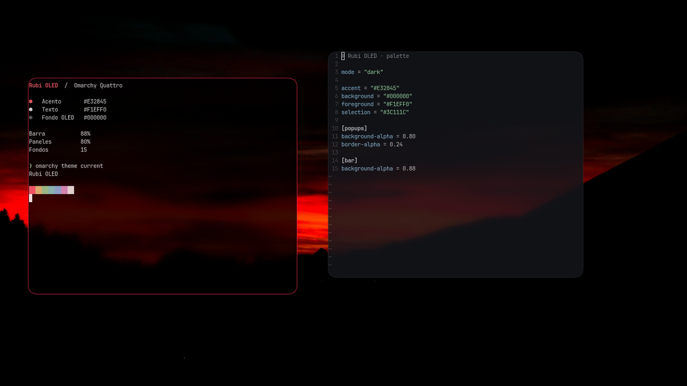
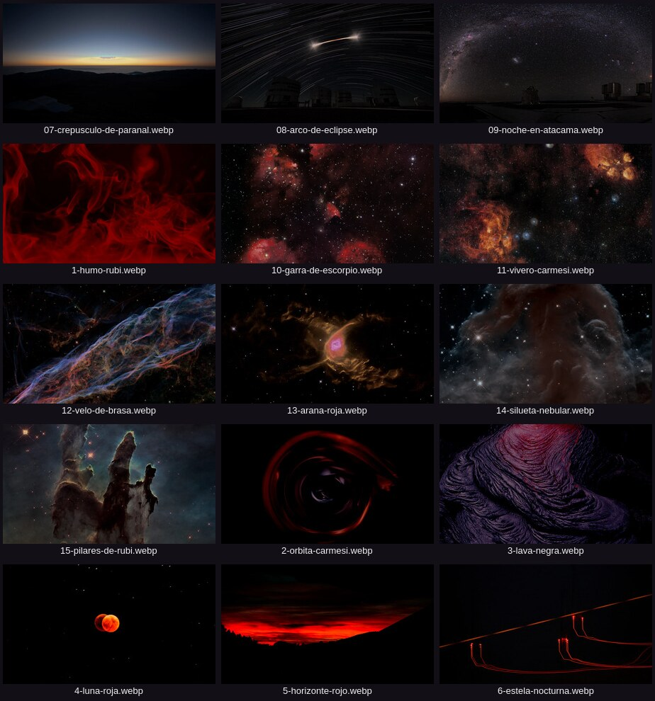

# Rubí OLED

Tema para **Omarchy Quattro** con negro puro, acento rubí y superficies translúcidas. Forma parte de [ElMeGGa OmaDesktop](https://github.com/megga-ernesto/ElMeGGa-OmaDesktop).

**Identificador de instalación** · `elmegga.rubi-oled`



## Instalación

```sh
omarchy theme install https://github.com/megga-ernesto/elmegga.rubi-oled
```

Omarchy aplica la paleta y las superficies del shell y genera los colores de terminal desde la paleta. El tema solicita el conjunto de iconos Yaru-red, si está disponible. Puedes alternar los fondos desde **Appearance → Background** o con **Super + Ctrl + W**.

## Apariencia

| Elemento | Valor |
|---|---|
| Fondo | `#000000` |
| Texto | `#F1EFF0` |
| Acento | `#E32845` |
| Barra | Fondo negro con alfa de 0.88 |
| Paneles | Fondo negro con alfa de 0.80 y borde de 1 px |

La paleta vive en [`colors.toml`](colors.toml). [`shell.toml`](shell.toml) configura barra, controles, paneles, lanzador, notificaciones y bloqueo. [`hyprland.lua`](hyprland.lua) y las configuraciones de Alacritty, Foot, Ghostty y Kitty son componentes para una copia local de confianza. Omarchy filtra esos archivos al instalar un tema por URL. La captura muestra una sesión real con el tema local. [Manual de temas personalizados de Omarchy](https://omarchy.org/manual/making-your-own-theme/)

## Fondos



Los [15 fondos](backgrounds/) incluyen seis imágenes de la edición original y nueve fotografías de ESO y ESA/Hubble recortadas y adaptadas a la paleta rubí. Consulta los [créditos de cada fondo y sus licencias](docs/fondos-creditos.md).

La configuración, la documentación y los seis fondos de la edición original se distribuyen bajo [MIT](LICENSE). Los nueve fondos de ESO y ESA/Hubble conservan **CC BY 4.0**.
